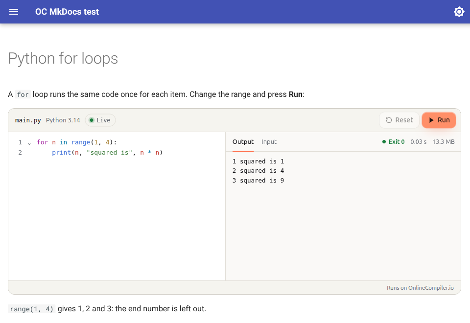

# Runnable code blocks for MkDocs and Material for MkDocs: interactive code examples in 46 languages

**mkdocs-onlinecompiler** turns the code examples in your MkDocs or Material for MkDocs site into interactive ones readers can edit and run, in Python, JavaScript, C++, Java, Go, SQL and 46 languages in all. Add the word `runnable` to a code block and readers get a live code editor with a Run button in the page, like a code playground, with no account and nothing to install.



````markdown
```python runnable
for n in range(1, 4):
    print(n, "squared is", n * n)
```
````

The code runs on [OnlineCompiler.io](https://onlinecompiler.io/?utm_source=pypi), a code execution service, in an isolated sandbox with no network access. Nothing runs on your server or in the reader's browser, so the same docs can run C++, Rust or SQL as easily as Python.

## Install

```bash
pip install mkdocs-onlinecompiler
```

Add it to `mkdocs.yml` with your widget key:

```yaml
plugins:
  - search
  - onlinecompiler:
      key: YOUR_WIDGET_KEY
```

Create a free widget key on the [Widgets page](https://api.onlinecompiler.io/compilers/widgets/) of your OnlineCompiler.io dashboard (sign in with Google), and set its allowed domain to your docs site's domain so other sites can't use it. Listing `plugins` replaces MkDocs' default list, so keep `search` in it if you use search.

## Write runnable examples

Add `runnable` after the language of any fenced code block:

````markdown
```cpp runnable
#include <iostream>

int main() {
    std::cout << "Hello from C++\n";
}
```
````

- **The block's language picks the compiler**: `python` runs Python 3.14, `cpp` runs C++ (G++ 15), `js` runs Node.js 24, `sql` runs SQLite. Compiler ids work too: `python-3.14`, `g++-15`.
- **`lang=` picks another one**: ```` ```python runnable lang=python-3.14-pandas2 ```` runs Python with pandas 2.
- **Attribute style works too**: ```` ``` {.python .runnable} ````, and other options stay: ```` ```python title="hello.py" runnable ````.
- **Code blocks without `runnable` stay as they are.** A runnable block in a language OnlineCompiler.io doesn't run stays plain code, and the build prints a warning naming the page and the language (so `mkdocs build --strict` stops on it).

Readers can change the code, type the program's input and run it again. Runners work in admonitions, content tabs and pages built from snippets, and with Material's instant navigation.

## Options

| Option | Default | What it does |
| --- | --- | --- |
| `key` | none | Your widget key. Without one, runnable blocks show as plain code and the build warns. |
| `theme` | `site` | `site` follows the light or dark mode of Material for MkDocs or MkDocs' own theme. `light`, `dark` or `auto` (the reader's system setting) fix it. |
| `languages` | `{}` | Your own code block languages, mapped to compiler ids: `{py3: python-3.14}`. |

To keep the key out of the config file, read it from the environment: `key: !ENV [ONLINECOMPILER_WIDGET_KEY, ""]`.

## Supported languages

Python, C, C++ (and C++20), Java, JavaScript (Node.js), TypeScript (Deno), C#, F#, Visual Basic, Go, Rust, PHP, Ruby, Kotlin, Swift, Dart, Scala, Groovy, Clojure, Haskell, OCaml, Elixir, Erlang, Racket, Common Lisp, Prolog, R, Julia, Octave, Fortran, COBOL, Pascal, Ada, D, Nim, Zig, Crystal, Perl, Lua, Bash, PowerShell, Objective-C, FreeBASIC, Assembly (NASM), SQL (SQLite) and DuckDB. Python includes NumPy, pandas, SciPy, scikit-learn and Matplotlib.

The full list of compiler ids is at [onlinecompiler.io/docs/compilers](https://onlinecompiler.io/docs/compilers?utm_source=pypi).

## FAQ

### How do I run Python code in MkDocs or Material for MkDocs?

Install this plugin, add your widget key to `mkdocs.yml`, and write `runnable` after the language of a Python code block (```` ```python runnable ````). Readers can then edit the code and run it in the page. The same works for C++, Java, Go, Rust, SQL and every other language in the list above.

### How is this different from markdown-exec, mkdocs-pyscript or pyodide-mkdocs-theme?

- **markdown-exec** runs code when the site is built and puts the output in the page, so readers see the result but can't change the code and run it again. (Its Pyodide blocks run Python in the browser, as below.)
- **Python in the browser** (mkdocs-pyscript, pyodide-mkdocs-theme, Pyodide blocks) runs Python only, inside the reader's browser, which first downloads a Python runtime.
- **This plugin** sends the code to a server sandbox, so it runs the real compilers and interpreters of 46 languages, including Python with NumPy and pandas, and readers can change the code and run it as often as they like. The reader's browser only shows the editor and the output.

### Does it slow down my docs?

No. Only pages with a runnable block load the widget script, without holding up the page, and each runner connects only when it scrolls into view. Pages without runnable blocks load nothing extra.

### Can search engines and MkDocs search read the code?

Yes. The code is in the page's HTML as text, so search engines and the site's own search index it, and readers see it before the editor loads.

### What do readers' runs cost?

Widget keys are free. Runs count towards your OnlineCompiler.io account's allowance; the Free plan includes 100,000 runs a month. Give the key its own monthly limit to cap what a public page can use.

### Is the widget key secret?

No. Widget keys are made to sit in public pages: they can run code in the widget but can't call the REST API. Restrict the key to your domain.

### What if OnlineCompiler.io can't be reached?

The code is in the page as text, so readers still see it. Only the Run button needs the service.

### Does it work with Docusaurus or WordPress too?

Yes: [docusaurus-plugin-onlinecompiler](https://github.com/onlinecompiler-io/docusaurus-plugin-onlinecompiler) for Docusaurus, and the [OnlineCompiler.io Code Runner](https://github.com/onlinecompiler-io/onlinecompiler-wordpress) plugin for WordPress. Any other site can use the [embeddable code editor](https://onlinecompiler.io/embeddable-code-editor?utm_source=pypi) directly.

## What it sends, and where

On pages with a runnable block, the reader's browser loads the widget script from `https://onlinecompiler.io/widget.js`. When a runner scrolls into view, the widget connects to `api.onlinecompiler.io` with your widget key; the browser adds your site's address, which is how the key's allowed domain is checked. When a reader presses Run, the widget sends the code, its input and the language, and shows the result. Readers don't sign in and the plugin sends nothing else about them. See the OnlineCompiler.io [privacy policy](https://onlinecompiler.io/privacy) and [terms](https://onlinecompiler.io/terms).

The widget itself, its options and its JavaScript API are documented at [onlinecompiler.io/docs/widget](https://onlinecompiler.io/docs/widget?utm_source=pypi).

## Requirements

MkDocs 1.5 or later on Python 3.10 or later. Tested with MkDocs 1.5 and 1.6 and Material for MkDocs 9.

## License

MIT
